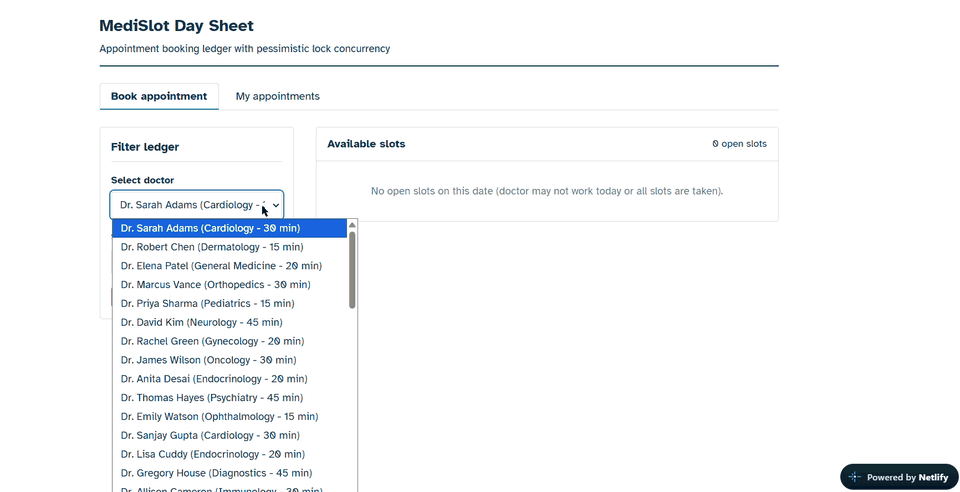
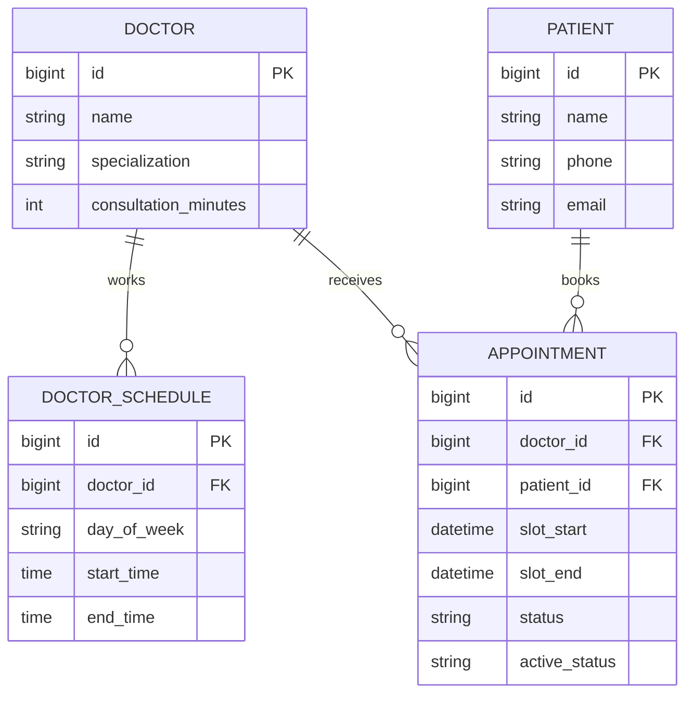

# MediSlot - Healthcare Slot Booking Platform

[](https://github.com/utkarshkulkarni45/MediSlot/actions/workflows/ci.yml)

MediSlot is a Spring Boot REST API with a clinic day-sheet frontend that prevents double-booking with pessimistic locking plus a database unique-constraint safety net.

---

## 🌐 Live Demo & Deployment Links

- **Live Application:** [https://medislot101.netlify.app/](https://medislot101.netlify.app/)
- **Backend API (Render):** [https://medislot-api-guw0.onrender.com](https://medislot-api-guw0.onrender.com)
- **Database:** Managed MySQL on Aiven Cloud

> **Note on Free-Tier Hosting:**  
> The backend is hosted on Render's free tier, which automatically spins down after 15 minutes of inactivity. **The very first request may take up to 60 seconds** while the container wakes up. Subsequent requests respond instantly!

> **Use fake data only.** The public demo has no authentication, and anything you submit is stored on a shared database. Do not enter real names, phone numbers, emails, or any other personal or medical information.

---

## 🎬 Demo

[](docs/media/medislot-demo.mp4)

*Click the preview above for the full recording ([medislot-demo.mp4](docs/media/medislot-demo.mp4), 27 MB).*

---

## 🌟 Key Highlights & Engineering Goals

1. **Double-Booking Prevention with Database Locking**:
   - Uses **Pessimistic Locking** (`@Lock(LockModeType.PESSIMISTIC_WRITE)`) inside an atomic `@Transactional` service boundary.
   - Enforces a composite **Database Unique Constraint** on `(doctor_id, slot_start, active_status)` as an inviolable secondary safety net.
   - Demonstrated by a **10-thread race test against MySQL 8 (Testcontainers)**: exactly 1 booking commits and 9 are rejected with `409 Conflict`, whether through the pre-check, a deadlock, or the unique constraint.
2. **Discrete Slot Interval Math**:
   - Slices doctor schedules into clean slots based on consultation minutes (e.g. 15, 30, 45 mins).
   - Drops indivisible remainder periods at schedule boundaries.
   - Strips already-booked slots and past slots for the current date, using the configured clinic timezone (`app.zone-id`, default `Asia/Kolkata`) instead of the server clock.
   - Validates that booking requests strictly align to the doctor's consultation grid (e.g. `09:10` is rejected for a 30-min interval).
3. **Centralized Exception Handling**:
   - Uniform error JSON shape across all endpoints using `@RestControllerAdvice`:
     ```json
     {
       "timestamp": "2026-10-28T22:50:00",
       "status": 409,
       "error": "Conflict",
       "message": "Slot starting at 2026-11-06T10:00:00 is already booked",
       "path": "/appointments"
     }
     ```
   - Proper HTTP status codes: `400` (Validation / Invalid Slot), `404` (Not Found), `409` (Conflict / Double-booking / Lock contention).

---

## 🛠️ Tech Stack

- **Java 21** (pinned in `pom.xml` and the Dockerfile)
- **Spring Boot 4.1.2** (Web, Data JPA, Validation, Actuator)
- **MySQL 8** (Runtime) & **H2 Database** (fast integration tests)
- **Testcontainers 2** (MySQL 8 concurrency test)
- **springdoc OpenAPI** (Swagger UI)
- **Project Lombok** & **Jakarta Bean Validation**
- **JUnit 5, Mockito & AssertJ**

---

## 🏗️ Architecture & Package Structure

```
com.utkarsh.medislot
 ├── controller          # HTTP REST API layer (DTO in, DTO out)
 │    ├── AppointmentController.java
 │    ├── DoctorController.java
 │    └── PatientController.java
 ├── service             # Core business rules & transaction boundary
 │    ├── AppointmentService.java
 │    ├── DoctorService.java
 │    ├── PatientService.java
 │    └── SlotGeneratorService.java
 ├── repository          # Spring Data JPA repositories with @Lock queries
 │    ├── AppointmentRepository.java
 │    ├── DoctorRepository.java
 │    ├── DoctorScheduleRepository.java
 │    └── PatientRepository.java
 ├── entity              # JPA database models
 │    ├── Appointment.java
 │    ├── AppointmentStatus.java (BOOKED, CANCELLED)
 │    ├── Doctor.java
 │    ├── DoctorSchedule.java
 │    └── Patient.java
 ├── dto                 # Request & Response POJOs
 ├── exception           # Custom exceptions + GlobalExceptionHandler
 └── MediSlotApplication.java
```

---

## 🚀 Setup & Running Locally

### Prerequisites
- JDK 21 (`java -version`)
- Maven 3.8+ (`mvn -v`)
- MySQL Server (optional; tests use H2, plus Docker for the MySQL Testcontainers test)

### 1. Clone the repository
```bash
git clone https://github.com/utkarshkulkarni45/MediSlot.git
cd MediSlot
```

### 2. Configure Database
`application.yml` reads the connection from environment variables, so no credentials belong in the repo. Defaults are `localhost:3306/medislot`, user `root`, empty password:

```bash
set DB_URL=jdbc:mysql://localhost:3306/medislot?createDatabaseIfNotExist=true&useSSL=false&serverTimezone=UTC
set DB_USERNAME=root
set DB_PASSWORD=your_password
set APP_ZONE_ID=Asia/Kolkata
set PORT=8080
```

> On macOS/Linux use `export` instead of `set`. In production these are `SPRING_DATASOURCE_URL`, `SPRING_DATASOURCE_USERNAME`, and `SPRING_DATASOURCE_PASSWORD` (see `application-prod.properties`).

### 3. Run All Tests
```bash
mvn test
```
The H2 suite runs everywhere. `MySqlConcurrencyBookingTest` starts a real MySQL 8 container through Testcontainers and is skipped automatically when Docker is not available.

### 4. Start the Application
```bash
mvn spring-boot:run
```
The server starts on port `8080`.

---

## 📡 API Reference & Sample Requests

### 1. Register a Doctor
`POST /doctors`
```bash
curl -X POST http://localhost:8080/doctors \
  -H "Content-Type: application/json" \
  -d '{
    "name": "Dr. Sarah Adams",
    "specialization": "Cardiology",
    "consultationMinutes": 30
  }'
```

### 2. List Doctors (paginated)
`GET /doctors?page=0&size=20`
```bash
curl "http://localhost:8080/doctors?page=0&size=20"
```
Returns a Spring `Page` (`content`, `totalElements`, `totalPages`, `number`, `size`). Defaults are page `0`, size `20`, sorted by name.

### 3. Add Working Schedule for a Doctor
`POST /doctors/{id}/schedules`
```bash
curl -X POST http://localhost:8080/doctors/1/schedules \
  -H "Content-Type: application/json" \
  -d '{
    "dayOfWeek": "MONDAY",
    "startTime": "09:00",
    "endTime": "13:00"
  }'
```

### 4. Get Available Slots for a Doctor on a Date
`GET /doctors/{id}/slots?date=YYYY-MM-DD`
```bash
curl "http://localhost:8080/doctors/1/slots?date=2026-11-02"
```

### 5. Register a Patient
`POST /patients`
```bash
curl -X POST http://localhost:8080/patients \
  -H "Content-Type: application/json" \
  -d '{
    "name": "Jane Doe",
    "phone": "+1234567890",
    "email": "jane.doe@example.com"
  }'
```

### 6. Book an Appointment
`POST /appointments`
```bash
curl -X POST http://localhost:8080/appointments \
  -H "Content-Type: application/json" \
  -d '{
    "doctorId": 1,
    "patientId": 1,
    "slotStart": "2026-11-02T09:30:00"
  }'
```

### 7. Cancel an Appointment
`PUT /appointments/{id}/cancel`
```bash
curl -X PUT http://localhost:8080/appointments/1/cancel
```

### 8. View Patient Appointment History
`GET /patients/{id}/appointments`
```bash
curl http://localhost:8080/patients/1/appointments
```

---

## 📘 API Docs & Health

- **Swagger UI:** [http://localhost:8080/swagger-ui.html](http://localhost:8080/swagger-ui.html)
- **OpenAPI JSON:** `GET /v3/api-docs`
- **Health check:** `GET /actuator/health`

---

## 💡 Design Decisions

### 1. Pessimistic vs. Optimistic Locking
- **What is Optimistic Locking?** Rows carry a `@Version` number. When updating, Hibernate executes `UPDATE ... WHERE version = expectedVersion`. If another transaction updated the row first, an `OptimisticLockException` is thrown.
- **What is Pessimistic Locking?** The database issues an exclusive row-level lock (`SELECT ... FOR UPDATE`) before changes are made, preventing concurrent transactions from acquiring or updating the row until the transaction commits.
- **Why Pessimistic Locking was chosen here:** In appointment scheduling, popular slots experience **high contention**. Under optimistic locking, multiple simultaneous requests would all proceed through the booking logic only to collide during commit, forcing repeated application-level retries and wasting CPU/database resources. Pessimistic locking serialises contenders before the insert, so the loser is rejected with a `409 Conflict` instead of both requests writing.

### 2. What the Pessimistic Lock Actually Locks
`findConflictingBookingWithLock` issues `SELECT ... FOR UPDATE` for the same `(doctor_id, slot_start, status = BOOKED)`, and that predicate is backed by the unique index on `(doctor_id, slot_start, active_status)`.

- **Slot already booked:** the query matches a row, so InnoDB takes an exclusive row lock. A competing transaction blocks until the first commits, then sees the row and gets `409`.
- **Slot not booked yet:** there is no row to lock. Under `REPEATABLE READ`, InnoDB takes a **gap / next-key lock** over the index range where the new row would be inserted. Two simultaneous inserts into that gap conflict; one commits and the other either re-reads the committed row (and is rejected) or is chosen as a **deadlock victim**. Lock failures and constraint violations are both mapped to `409`, never `500`.

Gap locking is InnoDB-specific and depends on the isolation level and index, so the logic does not rely on it alone.

### 3. Multi-Layer Concurrency Defense (Database Safety Net)
To eliminate any chance of a duplicate insert even if the lock is bypassed, there is a unique constraint:
```java
@Table(
    name = "appointments",
    uniqueConstraints = {
        @UniqueConstraint(name = "uk_doctor_slot_active", columnNames = {"doctor_id", "slot_start", "active_status"})
    }
)
```
- For active bookings (`status = 'BOOKED'`), `active_status` is `'BOOKED'`.
- When an appointment is cancelled, `active_status` is set to `null`.
- In SQL standards, `NULL` values do not conflict with each other. This allows cancelled historical bookings to stay in the database while allowing the exact same slot to be re-booked!

### 4. Thread-Safe Time Math
All time calculations leverage Java 8+ `java.time` types (`LocalDate`, `LocalTime`, `LocalDateTime`, `Duration`). They are immutable, thread-safe, and free from the concurrency bugs inherent to legacy `java.util.Date` and `java.util.Calendar`. "Now" comes from an injected `Clock` bound to `app.zone-id`, so the clinic's wall-clock time is used even when the server runs in UTC, and tests can control it.

---

## 🔄 Concurrent Booking Walkthrough

```mermaid
sequenceDiagram
    autonumber
    participant A as Request A
    participant B as Request B
    participant S as AppointmentService
    participant DB as MySQL InnoDB

    A->>S: POST /appointments (10:00 slot)
    B->>S: POST /appointments (10:00 slot)
    S->>DB: BEGIN; SELECT ... FOR UPDATE
    Note over DB: No row yet -> A holds a gap lock
    S->>DB: BEGIN; SELECT ... FOR UPDATE
    Note over DB: B blocks on A's lock
    A->>DB: INSERT appointment
    DB-->>A: COMMIT
    S-->>A: 201 Created
    Note over DB: B wakes: row now exists, or B is deadlock victim
    alt Committed row is now visible
        S-->>B: 409 Conflict (already booked)
    else B was chosen as the deadlock victim
        S-->>B: 409 Conflict (retry)
    end
```

## 🗃️ Data Model



---

## 🧪 Testing Verification

Run the entire suite via:
```bash
mvn clean test
```

| Test Class | Engine | Focus |
|---|---|---|
| `SlotGeneratorServiceTest` | Mockito | Interval slicing, divisibility, past-slot removal, fully-booked day, grid alignment |
| `BookingIntegrationTest` | H2 | Booking, double-booking block, cancellation, rebooking, past-slot rejection |
| `ConcurrencyBookingTest` | H2 | 10 threads race one slot -> exactly 1 succeeds, 9 fail |
| `MySqlConcurrencyBookingTest` | MySQL 8 (Testcontainers) | Same 10-thread race on InnoDB; skipped when Docker is unavailable |
| `GlobalExceptionHandlerTest` | Plain JUnit | Lock conflict, deadlock victim and unique-constraint failures all map to `409` |

The H2 run covers application logic; the MySQL run is the one that exercises InnoDB's real row/gap locking.

---

## ⚠️ Limitations & Roadmap

**Current limitations**
- **No authentication or authorization.** Anyone who can reach the API can list a patient's appointments (including phone and email) or cancel any appointment. Do not use real data.
- No rate limiting, so the public demo can be spammed.
- No email or SMS notifications.
- The schema is created by Hibernate `ddl-auto`, not by versioned migrations.
- Patient email is unique, but phone numbers are not.
- Doctor schedules for the same weekday overwrite each other; overlapping blocks are not rejected.
- Free-tier hosting cold-starts after 15 minutes idle.

**Roadmap**
- Spring Security with JWT and `PATIENT` / `DOCTOR` / `ADMIN` roles, taking the patient identity from the token rather than the request body.
- Flyway migrations, including the nullable `active_status` unique constraint as explicit SQL.
- Schedule overlap validation and unique phone numbers.
- Rate limiting and appointment reminders.

---

## 📄 License

MIT. See [LICENSE](LICENSE).


